<p align="center">
  
</p>

<h1 align="center">Jàngal — School fees on Lightning</h1>

<p align="center"><b>Money that can only become education.</b><br>
Frais de scolarité verrouillés sur le Lightning Network — l'argent n'atteint l'école
que si elle confirme la scolarisation, sinon il est remboursé automatiquement.</p>

<p align="center">
       
</p>

**🎬 3-min demo video:** https://youtu.be/fGDln6mZ5yo · **Presentation page:** https://imspsycho.github.io/jangal/ · **Run it:** `docker compose up --build` (see [DEPLOY.md](DEPLOY.md))

---

## The problem

In Senegal, education is the **largest family expense after food** — and a huge share
of school fees is paid by the **diaspora** (23% of households receive remittances).
Today that money travels through middlemen and cash, and everyone knows the failure
modes:

- the relative "helping" from Paris never forwards the full amount,
- fake receipts and skimmed fees,
- money sent "for school" becoming anything but school.

**Jàngal** (Wolof: *to educate*) makes the purpose of the money **enforceable**:

```
1. The school creates the fee invoice        (or photographs the fee note — AI parses it)
2. The diaspora parent pays in sats          → funds are LOCKED in a Lightning hold invoice
3. The school attaches the enrolment proof    → AI VISION verifies it against the fee record
4. The school confirms enrolment (one tap)    → the hold invoice settles, school is paid
5. A Nostr-signed receipt is published        → it anchors the PROOF HASH + AI verdict;
                                               family in Dakar is notified in Wolof
   …and if the school never confirms?        → the HTLC fails, funds return automatically
```

Nobody — not Jàngal, not a middleman, not the school — can redirect the money.
It is escrow **by Lightning math, not by a custodian** — with **AI-verified
evidence** anchored in every receipt.

## Quick start (one command)

```bash
docker compose up --build
# open http://localhost:3000
```

That boots the full stack: **bitcoind (regtest) + two LND nodes (school & parent) + the app**.
Wallets are created, the parent→school channel is opened and confirmed, demo schools,
students and one fee invoice are seeded automatically.

| Demo persona | Code | What to try |
|---|---|---|
| 👨‍👩‍👧 Ousmane Diop — diaspora parent, Paris | `1111` | Pay Mariama's 45 000 F fee → watch it **lock** |
| 🏫 École Mame Diarra Mbaye — school, Médina | `3333` | **Attach proof** (AI vision verdict) → **Confirm** → Nostr receipt |
| 👵 Aïda Diop — family, Dakar | `2222` | See notifications + simulated SMS in Wolof |

Also try: **reject** a payment (auto-refund), **simulate the hold-invoice
expiry** (⏱ — funds return with no custodian), paste a fee note into the
school's **AI parser**, ask the **assistant** in Wolof, upload a **proof photo**
(AI vision verdict, hash anchored in the receipt), and — the trust feature —
**open a receipt's public verify link without signing in**:
`/#/verify/<fee_id>` re-checks the Nostr signature, the school key, the payment
hash and re-hashes the evidence photo to prove it was never swapped
(screenshot 13 shows it turning red on a tampered photo). The school home also
shows secretariat KPIs (median lock→settle time, refund rate, AI-proof rate,
per-term totals) and exports the ledger as **CSV**; receipts can be shared on
**WhatsApp** straight from the app.

### No Docker? Mock mode / hosted demo

```bash
cd backend && LND_MODE=mock npm start        # API + simulated LND on :3000
cd frontend && npm run dev                   # vite dev server on :5173
```

`LND_MODE=mock` runs the **full hold-invoice state machine in simulation** —
the entire product (escrow, proof photos, AI verdicts, Nostr receipts) works
without any Lightning infrastructure. This is also how the hosted demo runs.

### Tests — 148 automated checks + 13-step browser journey

```bash
make test          # unit (43) + smoke E2E (21) + extended E2E (84) — ~2 min, no Docker
```

- **Unit (43)** — conversions, i18n parity (wo/fr/en), JWT tamper/expiry,
  Nostr sign→verify→forge, masked names, mock-LND hold-invoice lifecycle
- **Smoke E2E (21)** — full money path: lock, settle, refund, AI proof,
  receipt anchoring, balances
- **Extended E2E (84)** — RBAC matrix, auth bypass, input validation,
  illegal state transitions, **concurrent confirm+reject race (exactly one wins)**,
  **evidence-photo swap detected by the public verifier**, XSS inertness,
  security headers, relay protocol + forged-event rejection, rate limiting,
  40-parallel load burst (118 ms)
- **Browser journey (13/13, Playwright)** — a real Chromium walks the whole
  product loop (form → pay → AI proof → confirm → receipt → public verifier →
  assistant) on a fresh instance with hard API-state assertions after every
  click; plus live-tamper validation (an open verifier page turns red by
  itself when the photo is swapped, green again after restore — the verdict
  is re-checked every 5 s)

Full details and findings: [docs/test-report.md](docs/test-report.md)

## Architecture

```
┌──────────────── Diaspora parent (Paris) ────────────────┐
│  PWA (Wolof · Français · English, 63 KB gzipped)        │
└──────────────┬──────────────────────────────────────────┘
               │ REST + JWT cookie (rate-limited, helmet)
┌──────────────▼──────────────────────────────────────────┐
│  Fastify app                                             │
│   • fee state machine: awaiting → locked → settled/refund│
│   • AI layer: fee-note parser + trilingual assistant     │
│     + proof-photo vision verification                     │
│   • SQLite (users, fees, payments, receipts, proofs)      │
│   • embedded Nostr relay (ws://…/nostr)                  │
└───────┬──────────────────────────────┬───────────────────┘
        │ LND REST (hold invoices)     │ Nostr (kind 30078)
┌───────▼──────────┐          ┌────────▼─────────┐
│ LND school node  │◀─ HTLC ─▶│ LND parent node  │
└───────┬──────────┘          └────────┬─────────┘
        │  channel (10 M sats, regtest)│
┌───────▼──────────────────────────────▼─────────┐
│            bitcoind (regtest)                   │
└─────────────────────────────────────────────────┘
```

Details: [docs/architecture.md](docs/architecture.md) ·
Security: [docs/threat-model.md](docs/threat-model.md) ·
Numbers: [docs/impact.md](docs/impact.md)

## Screenshots (mobile PWA, 390px)

| Login personas | Parent fees (FR) | Funds locked | **Proof + AI verdict** |
|---|---|---|---|
| 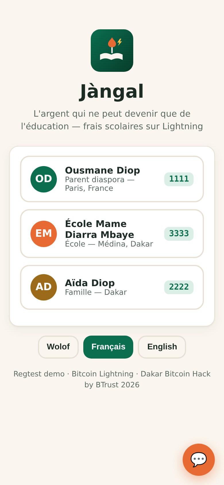 | 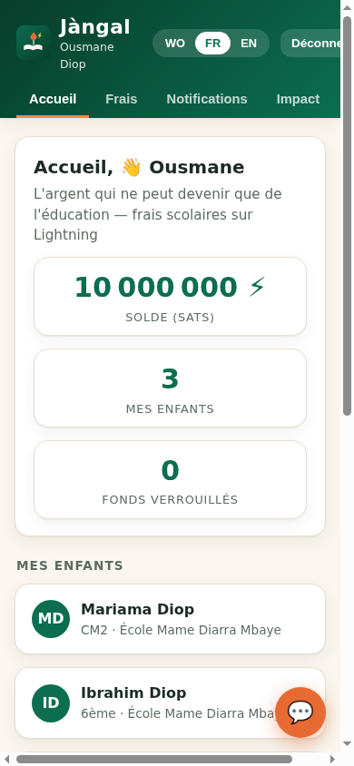 | 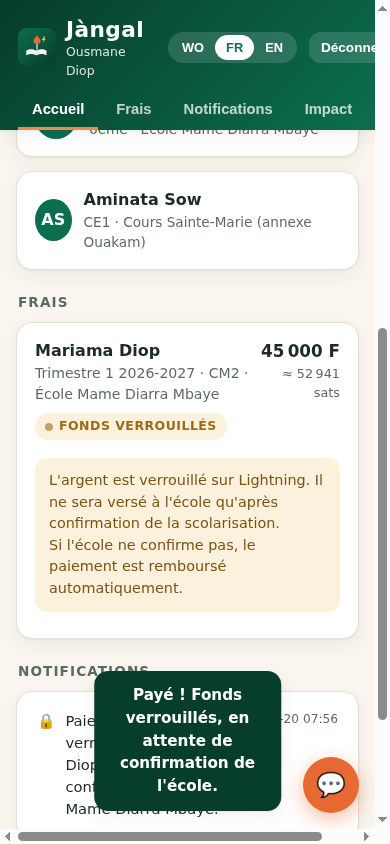 | 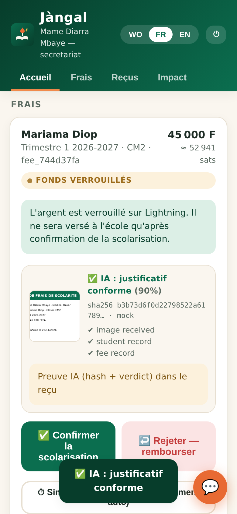 |

| Confirmed | Receipts (Nostr, valid) | **Receipt anchors the proof** | Family (Wolof) |
|---|---|---|---|
| 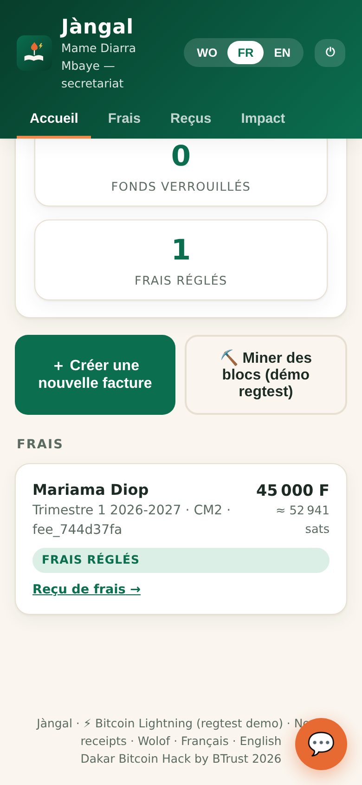 | 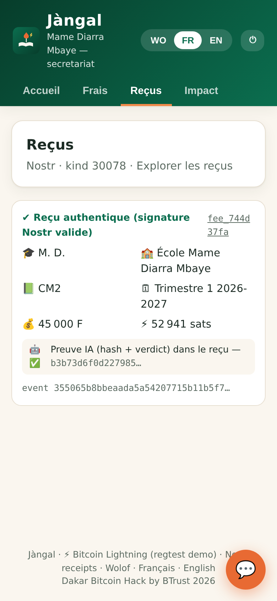 | 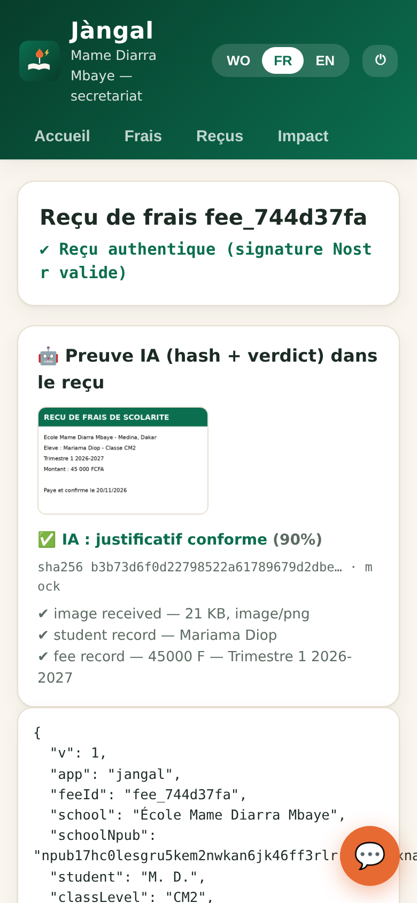 | 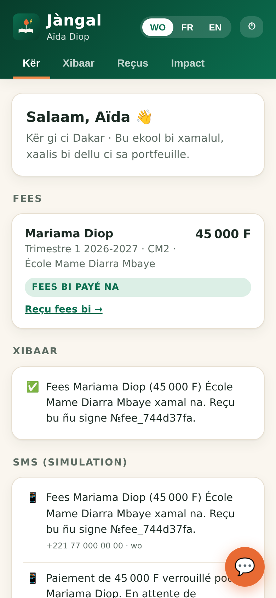 |

| **Public verifier (no login)** | Verifier (mobile) | School KPIs + CSV | **Tampered photo → red** |
|---|---|---|---|
| 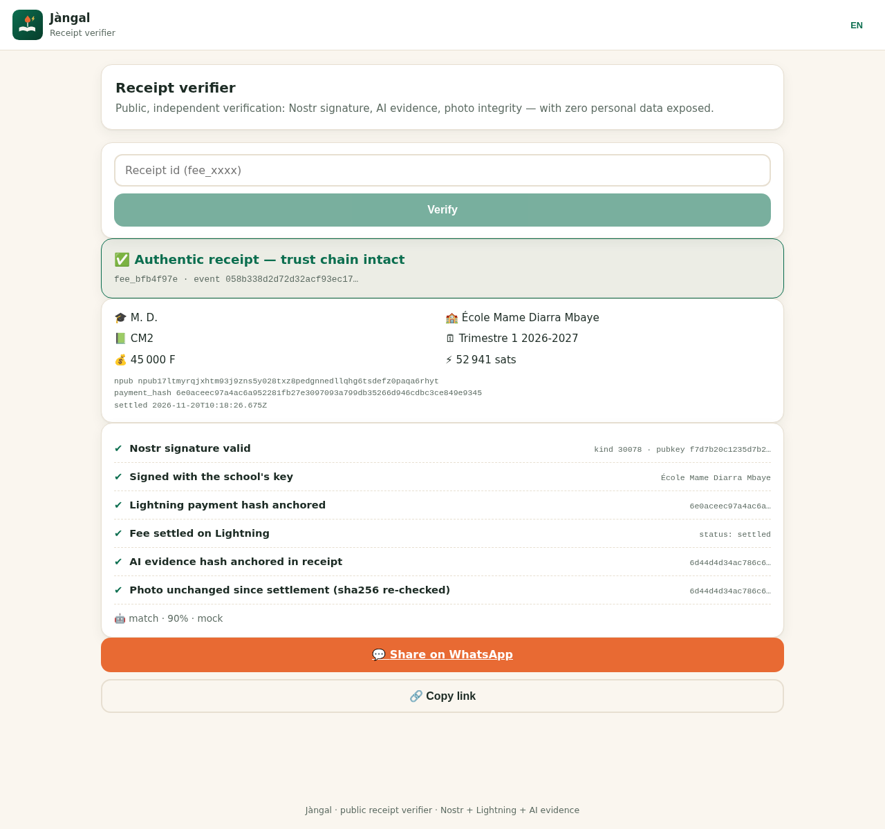 | 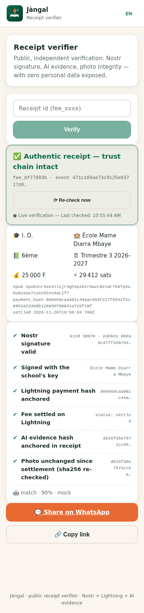 | 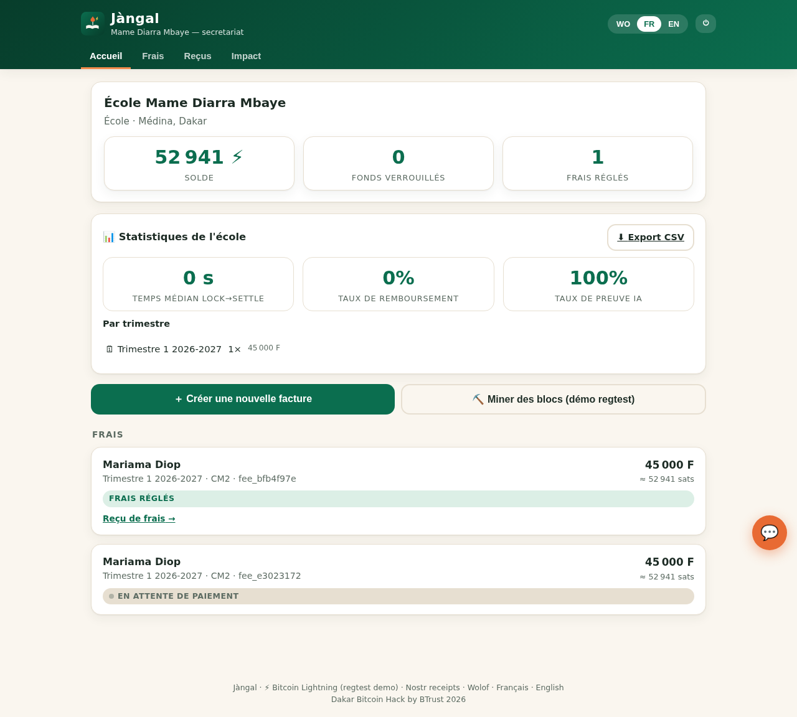 | 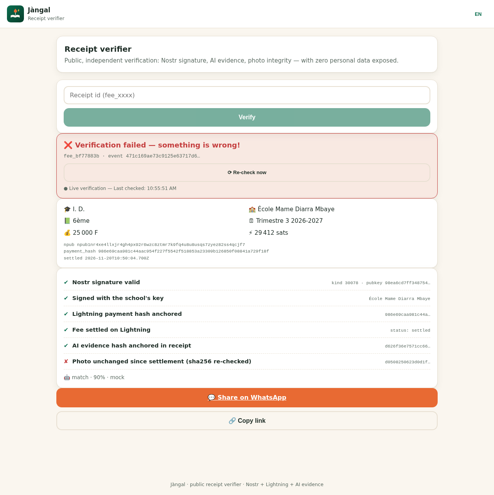 |

## Why this will matter in Senegal

- **Education is the #1 purpose of diaspora money** after food — and the most
  emotionally loaded. Payments happen 3× a year, per child, in cash.
- **Cost**: a Lightning payment costs a fraction of a cent vs 7–10% for
  traditional money-transfer operators.
- **Trust math**: the hold-invoice HTLC makes "I sent it" and "they received it"
  verifiable by both sides — with a Nostr receipt the family can check forever.
- **Language-first**: Wolof, French and English on every screen; SMS drafts for
  the family phone. See [docs/impact.md](docs/impact.md) for sources.

## What's real vs simulated

| Real (regtest) | Simulated / roadmap |
|---|---|
| LND hold-invoice escrow (add/settle/cancel) | FCFA fiat leg (real-world: local agent / Mobile Money partner) |
| Parent→school channel, HTLC lock & refund | SMS gateway (outbox table; Orange SMS API slot) |
| Nostr receipts (signed, relay-served, verifiable) | Phone-number auth (demo uses one-tap personas) |
| AI fee-note parser + assistant (mock or any OpenAI-compatible LLM) | School onboarding flow |
| **Proof-photo AI verification** (mock deterministic or any vision model) | SMS/WhatsApp proof delivery to the parent |
| **Proof hash + AI verdict anchored in Nostr receipts** | Mobile Money off-ramp for recipients without Bitcoin |
| Live composed FX rate (mempool.space × XOF peg, offline fallback) | |
| **Public receipt verifier** (Nostr sig + evidence sha256 re-check, no login) | |
| **School KPIs + CSV ledger export** | |

## Repo layout

```
├── docker-compose.yml      # bitcoind + lnd-school + lnd-parent + app
├── backend/                # Fastify API, LND client, Nostr relay, AI, seed, smoke test
├── frontend/               # React PWA (Vite, no UI kit, 63 KB gzipped)
├── scripts/demo-video/     # reproducible demo-video pipeline (Playwright + ffmpeg)
├── docs/                   # architecture, threat model, impact, video script, submission
└── docs/demo-video.mp4     # the 3-minute demo video (also at repo root)
```

## License

MIT — open source, as required by the hackathon rules.

---

*Built for the [Dakar Bitcoin Hack by BTrust 2026](https://dakar-bitcoin-hack-2026.devpost.com/) —
 Bitcoin · Lightning · Nostr · AI, for the lives of African people.* 🇸🇳
