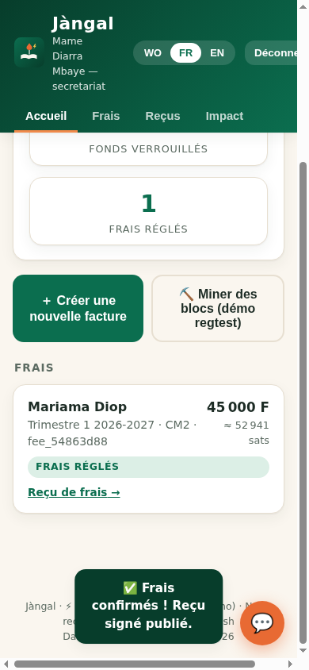
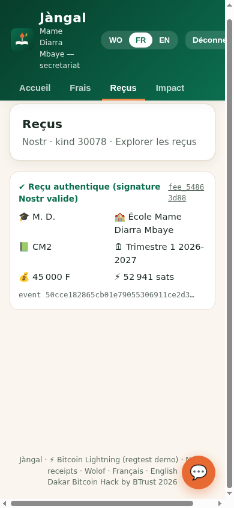
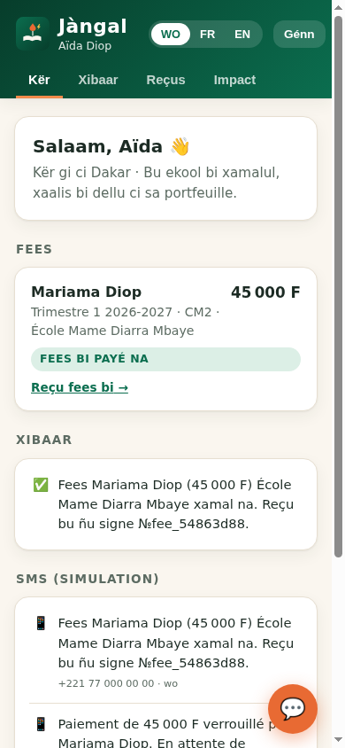

<p align="center">
  
</p>

<h1 align="center">Jàngal — School fees on Lightning</h1>

<p align="center"><b>Money that can only become education.</b><br>
Frais de scolarité verrouillés sur le Lightning Network — l'argent n'atteint l'école
que si elle confirme la scolarisation, sinon il est remboursé automatiquement.</p>

<p align="center">
      
</p>

---

## The problem

In Senegal, education is the **largest family expense after food** — and a huge share
of school fees is paid by the **diaspora** (23% of households receive remittances).
Today that money travels through middlemen and cash, and everyone knows the failure
modes:

- the relative "helping" from Paris never forwards the full amount,
- fake receipts and skimmed fees,
- money sent "for school" becoming anything but school.

**Jàngal** (Wolof: *to educate*) makes the purpose of the money **enforceable**:

```
1. The school creates the fee invoice        (or photographs the fee note — AI parses it)
2. The diaspora parent pays in sats          → funds are LOCKED in a Lightning hold invoice
3. The school confirms enrolment (one tap)   → the hold invoice settles, school is paid
4. A Nostr-signed receipt is published       → family in Dakar is notified in Wolof
   …and if the school never confirms?        → the HTLC fails, funds return automatically
```

Nobody — not Jàngal, not a middleman, not the school — can redirect the money.
It is escrow **by Lightning math, not by a custodian**.

## Quick start (one command)

```bash
docker compose up --build
# open http://localhost:3000
```

That boots the full stack: **bitcoind (regtest) + two LND nodes (school & parent) + the app**.
Wallets are created, the parent→school channel is opened and confirmed, demo schools,
students and one fee invoice are seeded automatically.

| Demo persona | Code | What to try |
|---|---|---|
| 👨‍👩‍👧 Ousmane Diop — diaspora parent, Paris | `1111` | Pay Mariama's 45 000 F fee → watch it **lock** |
| 🏫 École Mame Diarra Mbaye — school, Médina | `3333` | **Confirm** the locked fee → Nostr receipt is signed |
| 👵 Aïda Diop — family, Dakar | `2222` | See notifications + simulated SMS in Wolof |

Also try: **reject** a payment (auto-refund), paste a fee note into the school's
**AI parser**, ask the **assistant** in Wolof, and verify a receipt's Nostr signature
on the Reçus page. `make demo` runs the same flow end-to-end as a test.

### No Docker? UI development mode

```bash
cd backend && LND_MODE=mock npm start        # API + simulated LND on :3000
cd frontend && npm run dev                   # vite dev server on :5173
```

### Tests

```bash
cd backend && LND_MODE=mock node src/index.js &   # or docker compose up
node src/smoke.js                                 # 15 assertions, full happy path + refund
```

## Architecture

```
┌──────────────── Diaspora parent (Paris) ────────────────┐
│  PWA (Wolof · Français · English, 63 KB gzipped)        │
└──────────────┬──────────────────────────────────────────┘
               │ REST + JWT cookie (rate-limited, helmet)
┌──────────────▼──────────────────────────────────────────┐
│  Fastify app                                             │
│   • fee state machine: awaiting → locked → settled/refund│
│   • AI layer: fee-note parser + trilingual assistant     │
│     (mock provider by default — deterministic & offline) │
│   • SQLite (users, fees, payments, receipts, notifs)     │
│   • embedded Nostr relay (ws://…/nostr)                  │
└───────┬──────────────────────────────┬───────────────────┘
        │ LND REST (hold invoices)     │ Nostr (kind 30078)
┌───────▼──────────┐          ┌────────▼─────────┐
│ LND school node  │◀─ HTLC ─▶│ LND parent node  │
└───────┬──────────┘          └────────┬─────────┘
        │  channel (10 M sats, regtest)│
┌───────▼──────────────────────────────▼─────────┐
│            bitcoind (regtest)                   │
└─────────────────────────────────────────────────┘
```

Details: [docs/architecture.md](docs/architecture.md) ·
Security: [docs/threat-model.md](docs/threat-model.md) ·
Numbers: [docs/impact.md](docs/impact.md)

## Screenshots

| Parent pays (FR) | Funds locked (FR) | School confirms | Receipts (Nostr) | Family (WO) |
|---|---|---|---|---|
|  |  |  |  |  |

## Why this will matter in Senegal

- **Education is the #1 purpose of diaspora money** after food — and the most
  emotionally loaded. Payments happen 3× a year, per child, in cash.
- **Cost**: a Lightning payment costs a fraction of a cent vs 7–10% for
  traditional money-transfer operators.
- **Trust math**: the hold-invoice HTLC makes "I sent it" and "they received it"
  verifiable by both sides — with a Nostr receipt the family can check forever.
- **Language-first**: Wolof, French and English on every screen; SMS drafts for
  the family phone. See [docs/impact.md](docs/impact.md) for sources.

## What's real vs simulated

| Real (regtest) | Simulated / roadmap |
|---|---|
| LND hold-invoice escrow (add/settle/cancel) | FCFA fiat leg (real-world: local agent / Mobile Money partner) |
| Parent→school channel, HTLC lock & refund | SMS gateway (outbox table; Orange SMS API slot) |
| Nostr receipts (signed, relay-served, verifiable) | Phone-number auth (demo uses one-tap personas) |
| AI fee-note parser + assistant (mock or any OpenAI-compatible LLM) | School onboarding flow |

## Repo layout

```
├── docker-compose.yml      # bitcoind + lnd-school + lnd-parent + app
├── backend/                # Fastify API, LND client, Nostr relay, AI, seed, smoke test
├── frontend/               # React PWA (Vite, no UI kit, 63 KB gzipped)
└── docs/                   # architecture, threat model, impact, video script, submission
```

## License

MIT — open source, as required by the hackathon rules.

---

*Built for the [Dakar Bitcoin Hack by BTrust 2026](https://dakar-bitcoin-hack-2026.devpost.com/) —
 Bitcoin · Lightning · Nostr · AI, for the lives of African people.* 🇸🇳
